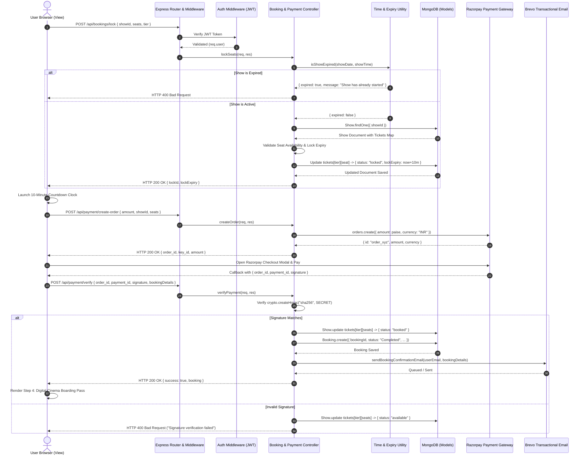

# 🏛️ System Architecture & MVC Pattern Implementation

This document provides a comprehensive technical overview of the **iMovies** platform architecture, detailing the implementation of the **Model-View-Controller (MVC)** design pattern across the decoupled React 18 client and Node.js/Express.js REST backend.

---

## 1. Architectural Overview

**iMovies** is built on a modern decoupled architecture separating presentation concerns (client-side React Single-Page Application) from persistence and business rules (server-side Express REST API and MongoDB).

```
┌────────────────────────────────────────────────────────────────────────┐
│                        VIEW LAYER (React 18 SPA)                       │
│  - React Router DOM v6 (Lazy Loading & Route Guards)                   │
│  - Tailwind CSS (Amazon Prime Video Dark Aesthetic)                    │
│  - Context API (AuthContext) & Axios HTTP Client Interceptors          │
│  - Dynamic Components (SeatMap, DigitalTicketPass, HeroBanner, etc.)   │
└───────────────────────────────────┬────────────────────────────────────┘
                                    │ HTTPS / JSON REST API
                                    ▼
┌────────────────────────────────────────────────────────────────────────┐
│                     CONTROLLER LAYER (Express.js)                      │
│  - Route Handlers & Input Validators                                   │
│  - JWT Authentication & RBAC Middleware (User vs. Admin)               │
│  - Business Logic: Seat Locking TTL, Showtime Expiry, HMAC Validation │
│  - Third-Party Services: TMDB v3, Razorpay Checkout, Brevo Email SDK   │
└───────────────────────────────────┬────────────────────────────────────┘
                                    │ Mongoose ODM
                                    ▼
┌────────────────────────────────────────────────────────────────────────┐
│                       MODEL LAYER (MongoDB Atlas)                      │
│  - Mongoose Schemas & Schema Validation Hooks                          │
│  - Pre-save Bcrypt Password Encryption                                 │
│  - Compound Unique Indexes (Reviews, Favorites)                        │
│  - Seat Reservation Matrices & 7-Day Auto-Provisioned Show Schedules   │
└────────────────────────────────────────────────────────────────────────┘
```

---

## 2. Model Layer (M)

The **Model Layer** manages data storage, schema definitions, integrity constraints, and database hooks using **Mongoose ODM** on MongoDB.

### 2.1 Model Registry

| Model | Schema File | Core Purpose | Indexing & Constraints |
|---|---|---|---|
| **User** | `models/userModel.js` | Customer identities, verification OTPs, password reset tokens | Unique `email`, unique `username`, pre-save bcrypt hook |
| **Admin** | `models/adminModel.js` | Administrator identities with privileged catalog access | Unique `email`, unique `username`, pre-save bcrypt hook |
| **Movie** | `models/movieModel.js` | Local database movie catalog entries | Indexed by `_id`, text search index on `movieName` |
| **Theatre** | `models/theatreModel.js` | Venues, multi-tier pricing, and coordinate seat layout maps | Unique `theatreName`, validated tier price bounds |
| **Show** | `models/showModel.js` | Film exhibition sessions with real-time seat status matrices | Unique `showId`, compound index `{ movieId: 1, showDate: 1 }` |
| **Booking** | `models/bookingModel.js` | Immutable reservation records, seat breakdowns, Razorpay audit tokens | Unique `bookingId`, indexed by `userEmail` |
| **Review** | `models/reviewModel.js` | User film ratings (1-5 stars) and text feedback | Compound unique index `{ userEmail: 1, movieId: 1 }` |
| **Favorite** | `models/favoriteModel.js` | Customer movie watchlists | Compound unique index `{ userEmail: 1, movieId: 1 }` |

### 2.2 Key Model Characteristics

#### Polymorphic / Mixed TMDB Movie References
In `showModel.js`, `bookingModel.js`, `reviewModel.js`, and `favoriteModel.js`, `movieId` is typed as `mongoose.Schema.Types.Mixed`. This design decision enables the system to support both native MongoDB ObjectIds (from internally seeded movies) and numeric/string TMDB IDs (e.g. `"872585"`) without casting exceptions (`CastError`).

#### Embedded Ticket State Hash Map
The `Show` model stores a seat map structured as:
```javascript
tickets: {
  lower: {
    A1: { status: 'available', lockedBy: null, lockExpiry: null },
    A2: { status: 'locked', lockedBy: 'user@example.com', lockExpiry: ISODate(...) },
    A3: { status: 'booked', lockedBy: 'user@example.com', lockExpiry: null }
  },
  middle: { ... },
  balcony: { ... }
}
```
This enables $O(1)$ seat status lookup and locking during high-concurrency reservation attempts.

---

## 3. View Layer (V)

The **View Layer** is implemented as an interactive, responsive React 18 Single-Page Application (SPA) styled with **Tailwind CSS** under the sleek **Amazon Prime Video** design language.

### 3.1 Design System & Aesthetic Tokens
- **Background Base**: `#0f171e` (Deep Prime Dark)
- **Surface Layer**: `#1a242f` (Prime Slate Surface)
- **Elevated Modals / Controls**: `#253241` (Prime Elevated Slate)
- **Brand Accent**: `#00a8e1` (Prime Cyan)
- **Typography**: `Inter`, system-ui, sans-serif

### 3.2 View Hierarchy & Routing Architecture

```
client/src/
├── components/                       # Reusable View Components
│   ├── Navbar.jsx                    # Header with debounced auto-complete search
│   ├── HeroBanner.jsx                # Auto-rotating billboard with TMDB original backdrops
│   ├── MovieCarousel.jsx             # Prime horizontal carousels with smooth touch/mouse drag
│   ├── MovieCard.jsx                 # Card scaling with hover actions (Play, Watchlist, Details)
│   ├── SeatMap.jsx                   # Interactive cinema screen & tier seat map (Lower to Balcony)
│   ├── DigitalTicketPass.jsx         # Cinema boarding pass with QR code, barcode, and PDF print
│   ├── TrailerModal.jsx              # Autoplay YouTube trailer embed in cinema modal
│   ├── ProtectedRoute.jsx            # Guard redirecting unauthenticated visitors to /login
│   ├── AdminRoute.jsx                # Guard enforcing administrator privileges
│   └── Footer.jsx                    # Footer layout
├── context/
│   └── AuthContext.jsx               # Global authentication provider (user, admin, tokens)
├── pages/
│   ├── LandingPage.jsx               # Public showcase & marketing banner
│   ├── LoginPage.jsx                 # Customer & Admin tabbed sign-in
│   ├── RegisterPage.jsx              # Customer sign-up initiating Brevo OTP email flow
│   ├── VerifyEmailPage.jsx           # Monospace 6-digit OTP verification interface
│   ├── ResetPasswordPage.jsx         # Password recovery with OTP verification
│   ├── HomePage.jsx                  # Main catalog with TMDB carousels & filter drawer
│   ├── MovieDetailsPage.jsx          # Comprehensive film details, cast avatars & reviews
│   ├── MovieShowsPage.jsx            # 7-day date picker with real-time past showtime filtering
│   ├── SeatSelectionPage.jsx         # 4-step wizard: Seat Map -> Summary -> Razorpay -> Pass
│   ├── BookingsPage.jsx              # User booking history with "View Boarding Pass" modal
│   ├── WatchlistPage.jsx             # User favorited movies gallery
│   └── admin/
│       ├── AdminDashboard.jsx        # Revenue analytics and management portal
│       ├── AddMoviePage.jsx          # Film ingestion form
│       ├── AddTheatrePage.jsx        # Venue & multi-tier pricing configuration
│       ├── AddShowPage.jsx           # Show scheduler
│       └── AdminBookingsPage.jsx     # Master booking auditor
```

### 3.3 Dynamic State & Interceptors
- **`AuthContext.jsx`**: Centralized authentication state tracking current user profile, token persistence in `localStorage`, and role differentiation (`isAdmin`).
- **`axios.js`**: Configured Axios instance automatically attaching `Authorization: Bearer <token>` headers on outgoing requests and handling HTTP 401 unauthorized redirections.

---

## 4. Controller Layer (C)

The **Controller Layer** encapsulates application business logic, incoming request validation, access control, and orchestration between database models and third-party APIs.

### 4.1 Controller Responsibilities

| Controller | File | Key Functions |
|---|---|---|
| **Auth Controller** | `controllers/authController.js` | User/Admin registration, password hashing, JWT signing, OTP generation, Brevo email activation, password recovery |
| **Movie Controller** | `controllers/movieController.js` | CRUD operations for movie catalog, keyword search |
| **Theatre Controller**| `controllers/theatreController.js`| Venue management, tier seat creation (Lower, Middle, Balcony) |
| **Show Controller** | `controllers/showController.js` | Showtime retrieval, 7-day automated MongoDB show provisioning across canonical theatres, fallback slug decomposition |
| **Booking Controller**| `controllers/bookingController.js`| Real-time showtime expiry validation, 10-minute seat locking (`/api/bookings/lock`), TTL management, reservation confirmation |
| **Payment Controller**| `controllers/paymentController.js`| Razorpay order creation (`/api/payment/create-order`), HMAC SHA-256 signature verification (`/api/payment/verify`), auto seat release |
| **Review Controller** | `controllers/reviewController.js` | Film rating and review submission, average rating calculation |
| **Favorite Controller**| `controllers/favoriteController.js`| Watchlist toggle, user favorite catalog retrieval |
| **Email Controller** | `controllers/emailController.js` | Transactional email dispatches via `@getbrevo/brevo` |

---

## 5. End-to-End Request Lifecycle & Data Flow

The following sequence diagram traces the complete lifecycle of a ticket reservation request through the MVC architecture:



---

## 6. Standardized API Response Patterns

All REST API endpoints adhere to consistent JSON response contracts.

### Success Contract
```json
{
  "success": true,
  "message": "Human-readable confirmation message",
  "data": { ... }
}
```

### Error Contract
```json
{
  "success": false,
  "message": "Specific error description explaining the failure reason"
}
```

### Common HTTP Status Codes
- `200 OK`: Request succeeded with data payload.
- `201 Created`: New resource successfully persisted (User, Movie, Theatre, Booking).
- `400 Bad Request`: Validation failure, expired showtime, or missing required payload parameters.
- `401 Unauthorized`: Missing, expired, or malformed JWT Bearer token.
- `403 Forbidden`: Insufficient role permissions (non-admin accessing administrator routes).
- `404 Not Found`: Target entity does not exist.
- `409 Conflict`: Seat lock contention or duplicate unique resource (username/email).
- `500 Internal Server Error`: Unhandled backend exception with sanitized error logging.

---

## 7. Security & Cross-Cutting Architecture

1. **Password Encryption**: Sensitive passwords hashed via `bcryptjs` with auto-generated salt rounds before database persistence.
2. **Dual Role Separation**: Strict RBAC separating customer permissions from administrative capabilities via `adminMiddleware.js`.
3. **Environment Isolation**: Production credentials (`RAZORPAY_KEY_SECRET`, `BREVO_API_KEY`, `JWT_SECRET`, `MONGO_URI`) isolated strictly in server-side `.env` files.
4. **Graceful Degradation**: Built-in mock models and offline fallbacks ensure complete system resilience if external networks (TMDB or Brevo) experience transient downtime.
