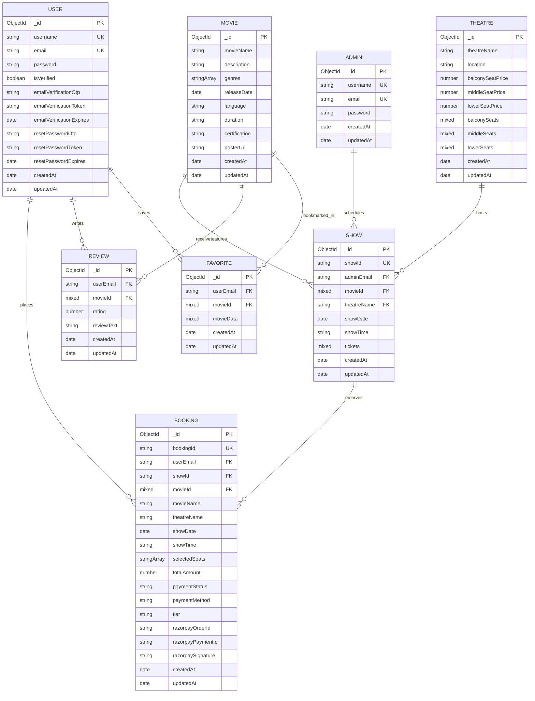

# 🗄️ Database Architecture & Entity-Relationship (ER) Diagram

This document outlines the entity relationships, schema designs, indexing strategies, and relational modeling implemented in the **iMovies** movie ticket booking platform using **MongoDB** and **Mongoose ODM**.

---

## 1. Entity-Relationship Diagram



---

## 2. Schema Deep-Dive & Design Decisions

### 2.1 User Model (`userModel.js`)
- **Primary Identifier**: MongoDB auto-generated `_id` (`ObjectId`).
- **Unique Constraints**: Unique indexed `username` (3-20 characters) and lowercase `email`.
- **Security Hooks**: Mongoose pre-save hook automatically executes `bcrypt.genSalt(10)` and `bcrypt.hash()` whenever the `password` field is modified.
- **Verification & Recovery Lifecycle**:
  - `emailVerificationOtp` & `emailVerificationToken`: For two-way registration authentication via Brevo.
  - `emailVerificationExpires`: Enforces 15-minute validity for activation tokens.
  - `resetPasswordOtp` & `resetPasswordExpires`: Enforces 15-minute validity for self-serve password resets.

### 2.2 Admin Model (`adminModel.js`)
- Dedicated administrative schema isolated from standard customer tables to enforce zero privilege escalation.
- Includes pre-save bcrypt hashing and custom instance method `comparePassword(candidatePassword)` for JWT generation.

### 2.3 Movie Model (`movieModel.js`)
- Represents internal local catalog films seeded or created through the Admin Dashboard.
- Handles certification ratings (`U`, `UA`, `A`), runtime durations, genre arrays, release date timestamps, and high-resolution posters.

### 2.4 Theatre Model (`theatreModel.js`)
- **Tier Pricing Strategy**:
  - `lowerSeatPrice`: Front-row economy tier nearest to the projection screen.
  - `middleSeatPrice`: Mid-auditorium executive standard tier.
  - `balconySeatPrice`: Furthest rear luxury recliner tier.
- **Seat Blueprint Layouts**:
  - `lowerSeats`, `middleSeats`, and `balconySeats` store row-column coordinate dictionaries (e.g., `{ A1: { total: 1, available: 1 } }`), allowing flexible venue seating arrangements.

### 2.5 Show Model (`showModel.js`)
- **Universal ID Compatibility**:
  - `movieId` is typed as `mongoose.Schema.Types.Mixed` to effortlessly reference both MongoDB native ObjectIds and TMDB string/numeric identifiers (e.g., `"872585"`).
- **Seat State Matrix (`tickets`)**:
  - Embedded tier hash tables (`tickets.lower`, `tickets.middle`, `tickets.balcony`) manage real-time seat states:
    ```javascript
    {
      status: 'available' | 'locked' | 'booked',
      lockedBy: 'user@example.com',
      lockExpiry: ISODate('2026-10-28T18:40:00Z')
    }
    ```
- **Real-Time Auto-Provisioning**:
  - When a user views showtimes for a movie that has not been explicitly pre-seeded, the backend auto-provisions a 7-day venue matrix across canonical theatres directly into MongoDB.

### 2.6 Booking Model (`bookingModel.js`)
- **Immutable Audit Record**:
  - Stores a snapshot of the movie, theatre, date, time, tier, and selected seat numbers to preserve historical data regardless of future schedule updates.
- **Razorpay Audit Tokens**:
  - `razorpayOrderId`: Gateway order identifier generated prior to modal display.
  - `razorpayPaymentId`: Verified payment token supplied by Razorpay upon successful capture.
  - `razorpaySignature`: Cryptographic proof validated via HMAC SHA-256.

### 2.7 Review Model (`reviewModel.js`)
- **Compound Unique Index**:
  - `{ userEmail: 1, movieId: 1 }` with `{ unique: true }` guarantees that each user can submit exactly one review per film while enabling in-place rating updates.

### 2.8 Favorite / Watchlist Model (`favoriteModel.js`)
- **Compound Unique Index**:
  - `{ userEmail: 1, movieId: 1 }` prevents duplicate watchlist entries.
  - `movieData` stores a snapshot of the poster, title, and release year to avoid additional round-trip API queries when loading the user's watchlist.

---

## 3. Indexing & Integrity Strategies

| Collection | Indexed Fields | Index Type | Purpose |
|---|---|---|---|
| `users` | `email` | Unique | Fast lookup on sign-in and duplicate email prevention |
| `users` | `username` | Unique | Unique username enforcement |
| `admins` | `email` | Unique | Admin authentication isolation |
| `shows` | `showId` | Unique | Slug and composite ID lookup (`tmdb_{id}_{day}_{theatre}_{time}`) |
| `shows` | `movieId`, `showDate` | Compound | Fast showtime retrieval for movie and date tabs |
| `bookings` | `bookingId` | Unique | Barcode / QR reference validation |
| `bookings` | `userEmail` | Standard | Quick lookup for "My Bookings" page |
| `reviews` | `userEmail`, `movieId` | Compound Unique | Enforces 1 review per user per title |
| `favorites` | `userEmail`, `movieId` | Compound Unique | Enforces 1 watchlist item per user per title |
