# 🧭 User Journey & Flow Diagram

This document illustrates the end-to-end user experience of the **iMovies** cinema platform, covering user onboarding, movie discovery, showtime filtering, interactive seat selection, payment processing, digital cinema pass generation, and administrative management.

---

## 1. Complete User Flowchart

```mermaid
flowchart TD
    %% Entry & Authentication
    Start(["Visitor Opens iMovies"]) --> Landing["Landing Page"]
    Landing --> AuthDecision{"Has Account?"}
    
    AuthDecision -- "No" --> Register["Register Page"]
    Register --> BrevoOTP["Brevo Sends 6-Digit OTP & Link"]
    BrevoOTP --> VerifyEmail["Verify Email Page"]
    VerifyEmail --> AuthSuccess["Account Activated"]
    
    AuthDecision -- "Yes" --> Login["Sign In Page"]
    Login --> ForgotPass{"Forgot Password?"}
    ForgotPass -- "Yes" --> ResetPass["Reset Password Page (OTP Dispatch)"]
    ResetPass --> Login
    ForgotPass -- "No" --> CredentialsCheck{"Valid Credentials?"}
    CredentialsCheck -- "No" --> LoginError["Error Toast & Retry"]
    LoginError --> Login
    CredentialsCheck -- "Yes" --> AuthSuccess

    %% Home & Discovery
    AuthSuccess --> Home["Home Page (Prime Video Aesthetic)"]
    Home --> BrowseMode{"Browsing Preference"}
    
    BrowseMode -- "Search" --> AutoComplete["Search Auto-Complete (Debounced)"]
    BrowseMode -- "Filter" --> FilterDrawer["Genre, Language & Year Drawer"]
    BrowseMode -- "Carousels" --> MovieCarousels["Trending, Now Showing, Top Rated"]
    
    AutoComplete --> SelectMovie["Select Movie Card"]
    FilterDrawer --> SelectMovie
    MovieCarousels --> SelectMovie
    
    %% Movie Details
    SelectMovie --> MovieDetails["Movie Details Page"]
    MovieDetails --> WatchlistAction["Add / Remove Watchlist"]
    MovieDetails --> TrailerModal["Watch YouTube Trailer Modal"]
    MovieDetails --> ReadReviews["Read & Post Customer Reviews"]
    MovieDetails --> ClickBook["Click 'Book Tickets'"]

    %% Showtimes & Filtering
    ClickBook --> MovieShows["Movie Shows Page"]
    MovieShows --> SelectDate["Select Date (7-Day Carousel)"]
    SelectDate --> CheckExpiry{"Is Date Today?"}
    CheckExpiry -- "Yes" --> TimeFilter["Compare Showtime with Current Time"]
    TimeFilter --> ExpiredSlots["Past Slots Disabled (Struck-through)"]
    TimeFilter --> ActiveSlots["Active Upcoming Showtimes"]
    CheckExpiry -- "No" --> ActiveSlots
    
    ActiveSlots --> ChooseSlot["Select Showtime at Target Theatre"]
    
    %% Seat Selection & Lock
    ChooseSlot --> SeatSelection["Seat Selection Page (Screen at Top)"]
    SeatSelection --> ViewGrid["View Tier Grid: Lower (Front) -> Middle -> Balcony (Rear)"]
    ViewGrid --> PickSeats["Pick 1 to 10 Seats"]
    PickSeats --> ClickProceed["Click 'Proceed to Summary'"]
    ClickProceed --> LockAPI["Backend POST /api/bookings/lock"]
    
    LockAPI --> LockCheck{"Seats Available?"}
    LockCheck -- "Conflict" --> ConflictToast["Toast: Seats Reserved by Another Customer"]
    ConflictToast --> ViewGrid
    LockCheck -- "Success" --> TTLTimer["10-Minute TTL Countdown Starts"]
    
    %% Order Summary & Payment
    TTLTimer --> OrderSummary["Order Summary Review"]
    OrderSummary --> PayAction["Click 'Pay with Razorpay'"]
    PayAction --> RazorpayModal["Official Razorpay Checkout Modal"]
    
    RazorpayModal --> PayMethod{"Select Method"}
    PayMethod --> UPI["UPI (GPay, PhonePe, Paytm, QR)"]
    PayMethod --> Cards["Debit / Credit Cards"]
    PayMethod --> NetBanking["NetBanking & Wallets"]
    
    UPI --> ProcessPay["Gateway Authorization"]
    Cards --> ProcessPay
    NetBanking --> ProcessPay
    
    ProcessPay --> PayResult{"Payment Status"}
    PayResult -- "Dismiss / Failure" --> ReleaseSeats["Seats Unlocked & Released"]
    ReleaseSeats --> OrderSummary
    
    PayResult -- "Success" --> VerifyAPI["Backend POST /api/payment/verify"]
    VerifyAPI --> HMACCheck{"Valid HMAC SHA-256?"}
    HMACCheck -- "No" --> FailVerify["Signature Mismatch Error"]
    FailVerify --> ReleaseSeats
    HMACCheck -- "Yes" --> MarkBooked["Show Tickets Marked 'Booked' in DB"]
    
    %% Digital Cinema Pass
    MarkBooked --> CreateBookingDoc["Booking Document Created"]
    CreateBookingDoc --> BrevoEmail["Brevo Dispatches Confirmation Email"]
    CreateBookingDoc --> DigitalPass["Step 4: Digital Cinema Boarding Pass"]
    DigitalPass --> PassFeatures["QR Code · Barcode · Print / Save PDF"]
    DigitalPass --> MyBookings["Navigate to 'My Bookings'"]
    DigitalPass --> ReturnHome["Navigate to Home"]

    %% Admin Workflow (Side Branch)
    Login -. "Admin Credentials" .-> AdminDash["Admin Dashboard"]
    AdminDash --> AddMovie["Add New Movie to Catalog"]
    AdminDash --> AddTheatre["Configure Theatre & Seat Layouts"]
    AdminDash --> AddShow["Schedule New Shows"]
    AdminDash --> ViewAllBookings["Live Analytics & Booking Audit"]
```



---

## 2. Step-by-Step Journey Walkthrough

### Phase 1: Onboarding & Authentication
1. **Visitor Landing**: A new user arrives at the landing page featuring billboard teasers and a high-level value proposition.
2. **Account Creation**: The user enters their `username`, `email`, and `password`. The Express backend hashes the password using `bcrypt` and generates a 6-digit OTP alongside an email verification token.
3. **Email Verification Gate**: Unverified accounts are strictly gated. The user checks their inbox for the **Brevo transactional email** and either types the 6 digits in the interactive OTP input or clicks the direct activation link.
4. **Session Activation**: Upon verification, a JSON Web Token (JWT) is issued, saved in `localStorage`, and attached to future API requests via Axios request interceptors.

---

### Phase 2: Movie Discovery & Interactive Showcase
1. **Hero Billboard**: Users explore auto-rotating hero showcases with high-resolution TMDB original backdrops, certifications, and genres.
2. **Dynamic Carousels**: Real-time cinema feeds categorize titles into *Trending*, *Now Playing*, *Top Rated*, and *Upcoming*.
3. **Live Auto-Complete Search**: Typing in the navigation search bar triggers a 300ms debounced auto-complete query returning instant poster thumbnails.
4. **Multi-Select Filter Drawer**: Users can filter movies by genre (Action, Sci-Fi, Drama, etc.), audio language, and release year.
5. **Details & Trailer Modal**: On `/moviedetails/:movieId`, users can review runtime, ratings, cast avatars, read community reviews, and launch YouTube trailers in an in-app cinema player.

---

### Phase 3: Real-Time Showtime & Venue Selection
1. **7-Day Dynamic Calendar**: Users select a target date from the horizontal day picker.
2. **Real-Time Expiry Validation**:
   - If the selected date is **Today**, the client and backend compare the showtime slot against local current time.
   - If a show has already begun (e.g., 10:00 AM when the current time is 4:30 PM), the slot is automatically struck through, greyed out (`opacity-40 cursor-not-allowed`), and marked with a `"Started / Expired"` badge.
   - Upcoming slots remain clickable and transition the user to the seat selection view with state parameters intact.

---

### Phase 4: Tier-Based Seat Selection & Real-Time TTL Locking
1. **Screen Orientation**: The cinema projection screen (*"SCREEN THIS WAY"*) is placed directly in front of the lowest-priced tier.
2. **Auditorium Tier Hierarchy**:
   - **Lower (Rows A–C)**: Front-row classic seating nearest to the screen (₹180–₹240).
   - **Middle (Rows D–G)**: Mid-auditorium executive seating (₹290–₹380).
   - **Balcony (Rows H–K)**: Premium rear recliner seating (₹400–₹550).
3. **Seat State Colors**:
   - 🟢 `Available`: Default seat color (`#253241` with cyan border).
   - 🔷 `Selected`: Active selection (`#00a8e1` with scale effect).
   - 🟡 `Locked`: Temporarily held by another user in active checkout.
   - ⚫ `Booked`: Confirmed reservation (grayed out).
4. **10-Minute Lock TTL**:
   - Clicking **Proceed** sends a `POST /api/bookings/lock` payload.
   - The backend checks seat availability in `show.tickets`, marks them as `locked`, attaches the user's email, and sets `lockExpiry = now + 10 minutes`.
   - The UI launches a live 10-minute countdown clock. If the timer reaches zero before payment, seats are released back to the general pool automatically.

---

### Phase 5: Razorpay Checkout & Cryptographic Verification
1. **Order Creation**: The client requests `/api/payment/create-order`. The server creates a signed Razorpay Order in paise.
2. **Razorpay Modal (`checkout.js`)**: Users choose between UPI (Google Pay, PhonePe, Paytm, UPI QR), Credit/Debit Cards, or NetBanking.
3. **HMAC SHA-256 Verification**: Upon payment completion, the callback passes `razorpay_order_id`, `razorpay_payment_id`, and `razorpay_signature` to `/api/payment/verify`.
4. **Signature Validation**:
   ```javascript
   const expectedSignature = crypto
     .createHmac('sha256', process.env.RAZORPAY_KEY_SECRET)
     .update(`${razorpay_order_id}|${razorpay_payment_id}`)
     .digest('hex');
   ```
5. **Database Finalization**: On a valid match, the show's seat records transition from `locked` to `booked`, a permanent `Booking` document is recorded, and Brevo automatically dispatches an HTML ticket receipt to the customer's email.

---

### Phase 6: Digital Cinema Boarding Pass
1. **Cinema Pass Presentation**: Step 4 renders a digital boarding pass with perforated ticket cutouts, dashed stub divider, and clean Prime Video styling.
2. **Pass Details**:
   - Movie poster & title, Theatre name, Screen/Audi number (`Audi 02`).
   - Show date, showtime, and audio format (`Dolby Atmos 4K`).
   - Grouped seat breakdown (e.g. `Row H · Seats 4, 5`) and tier category.
   - Dynamic scannable QR Code and simulated barcode encoding the ticket token.
   - Official Razorpay transaction identifiers.
3. **Export Actions**: Users can copy the reference code or click **Print / Save Ticket (PDF)** for contactless turnstile admission.
4. **My Bookings Integration**: All completed tickets remain accessible in `/bookings` with an on-demand modal boarding pass view and cancellation support for future showtimes.

---

### Phase 7: Administrative Control
1. **Admin Authentication**: Dedicated credentials authenticate at `/login` and redirect to `/admin`.
2. **Dashboard Metrics**: Live calculations of total revenue (₹), bookings count, movies in circulation, and registered theatres.
3. **Catalog Management**: Creation portals for adding movies, configuring multi-tier theatre layouts, scheduling show sessions, and auditing all customer bookings.
